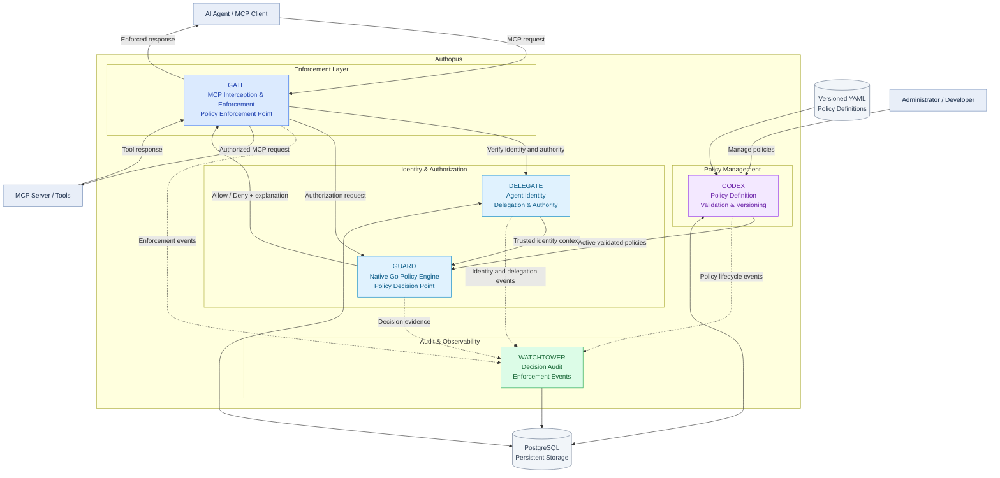

# Authopus

The core problem in the current AI Agent implementations is the absence of a consistent, interoperable, and developer-friendly security layer that makes AI agent identity, delegated authority, fine-grained authorization, runtime enforcement, and accountability work together.

Authopus aims to address this problem through an open-source platform that provides centralized AI agent identity, authorization, policy enforcement, delegation, and accountability.

Authopus aims to provide production-grade security infrastructure that developers and organizations can adopt, deploy, integrate, and extend.

The fundamental question Authopus seeks to answer is:

> Which agent is attempting what action, on whose behalf, under what authority, is that action permitted and how can the decision and outcome be verified?

## Core architecture

Authopus follow a modular architecture:

Refer to [architecture.md](./docs/architecture/architecuture.md) for more details

### Modules responsibility

- Gate: Intercepts requests and enforces authorization decisions
- Delegate: Establish trusted agent identity and delegated authority
- Guard: Evaluates authorization using native policy evaluation Engine
- Codex: Validates, versions and activates YAML policies
- Watchtower: Records security decisions, policy changes and enforcement outcomes

### Key architectural properties

- Single deployment: All modules within one service.
- MCP-first: Provide enforcement for MCP tools and resource interactions
- Fail-closed authorization: Unresolved, invalid or failed authorization never results in implicit permission
- Gate is the policy enforcement point while Guard is the policy decision point

