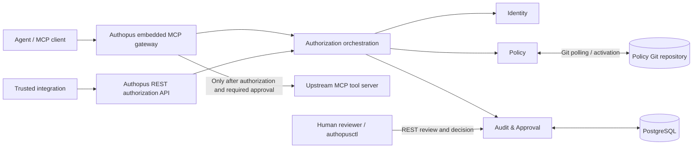

# Authopus — System Architecture

**Release:** `v0.1.0`
**Status:** Architecture baseline 
**Date:** November 2, 2026  
**Deployment model:** Single organization; one Go service and PostgreSQL

## 1. Purpose

Authopus is an open-source security layer for AI-agent actions. Its central audit question is:

> Which agent took what action under whose authority on behalf of whom?

The `v0.1.0` supported enforcement path is **MCP tool calls through an embedded gateway**. Authopus authenticates callers and agents, validates delegated or self-owned authority, evaluates native YAML policies, enforces allow/deny/approval-required outcomes, and durably records security-relevant events. Authopus does **not** prevent bypass when clients connect directly to upstream MCP servers outside its configured enforcement point.

## 2. Architectural decisions

| Concern | Decision |
|---|---|
| Deployment | One Go service with five internal modules; not microservices |
| Modules | Identity; Policy; Authorization; Enforcement; Audit & Approval |
| Enforcement | Embedded MCP gateway; MCP `tools/call` only in v0.1.0 |
| External authorization | REST API for explicitly trusted integrations |
| Identity | OIDC-authenticated agents or OIDC-authenticated trusted integrations permitted to assert bounded agent identities |
| Authority | Signed delegation token for `delegated`; explicit verified workload authority for `self` |
| Policy | Native deterministic Go evaluator; Git-managed versioned YAML |
| Policy version | `authopus.dev/v1alpha1`; one document contains multiple rules |
| Policy outcomes | `deny > require_approval > allow`; default deny; order-independent |
| Selectors | Exact identifiers, lists and global `*` only; no glob patterns |
| API outcomes | `ALLOW`, `DENY`, `APPROVAL_REQUIRED`, `ERROR` |
| Approval | REST and CLI review; one-time, bound to original request; revalidate before execution |
| Persistence | PostgreSQL, `pgx/v5` with explicit SQL; goose SQL migrations |
| Failure | Fail closed, including failure to persist mandatory audit records |
| Operations | Docker Compose, private PostgreSQL network, explicit migrations |
| HTTP/CLI | `net/http` ServeMux; standard-library `flag` |

### Why a modular monolith

One deployable process minimizes distributed-system complexity, service-to-service authentication, network hops, operational overhead and deployment friction for an initial single-organization security product. Internal package boundaries preserve separation of responsibility and allow evolution without requiring premature microservices. Tradeoffs include shared scaling, release and fault domains.

### Why Go

The service is network- and concurrency-oriented (OIDC/JWKS retrieval, REST authorization, MCP forwarding, PostgreSQL access). Go provides a suitable networking/runtime model, straightforward deployment and a compact operational footprint. Rust remains a possible option for low-level systems components, but is not the primary language.

### Why a native policy engine

Authopus requires control over policy semantics, explainability, deterministic evaluation and security review, while avoiding a broad external policy runtime. The tradeoff is ownership of parsing, validation, operator semantics, correctness and test coverage.

## 3. System context



The diagram shows logical responsibilities. **Identity, Policy, Authorization, Enforcement and Audit & Approval run inside the same Go service**, not as separately deployed services. PostgreSQL and the Git repository are external dependencies. A03 REST endpoints are for trusted integrations, not arbitrary untrusted internet clients.

## 4. Module responsibilities and boundaries

### 4.1 Identity (`internal/identity`)

- Validate configured OIDC issuers, signatures, audiences, expiry and other required claims.
- Resolve the agent from its own verified OIDC identity **or** an authenticated integration's explicitly authorized assertion.
- Resolve the principal (human, service, or workload/agent) and authority mode.
- For `delegated`, validate signed, scoped, time-bounded evidence binding principal, agent, action and resource.
- For `self`, require verified agent/workload principal and independently granted workload authority; never silently downgrade failed delegation to `self`.
- Produce trusted typed identity/authority context; do not trust request body or forwarded headers as authority evidence.

Identity does not itself decide policy permission.

### 4.2 Policy (`internal/policy`)

- Parse and validate `authopus.dev/v1alpha1` YAML documents containing rule lists.
- Match exact action/resource identifiers, lists and global wildcard only.
- Evaluate deterministic, bounded typed conditions against trusted context.
- Resolve all applicable rules independent of ordering: **deny > require_approval > allow**, then default deny.
- Return matching rule identifiers and explanation metadata.
- Poll Git, validate complete candidate policy sets before atomic activation, retain last-known-good state and support rollback. Invalid updates never become active.
- Reject unsupported and legacy schema versions; no implicit migration.

The exact condition operator catalogue, cross-document conflict rules and Git activation mechanics require normative A10–A13 implementation specifications; until finalized, implementations must not invent permissive behavior. Global deny precedence across active policies is the intended safety invariant.

### 4.3 Authorization (`internal/authorization`)

- Orchestrate identity, principal authority, delegation, policy and approval requirements.
- Expose A03 REST endpoints to authenticated trusted integrations.
- Return distinct `ALLOW`, `DENY`, `APPROVAL_REQUIRED` and `ERROR` outcomes; do not collapse infrastructure errors into policy denials.
- Support single-decision retrieval, not arbitrary decision search.
- Correlate decisions with policy version, request fingerprint and durable audit evidence.

**A policy ALLOW is necessary but not sufficient**: caller privileges, agent privileges, principal authority and delegation scope remain independent mandatory gates.

### 4.4 Enforcement (`internal/enforcement`)

- Host the MCP gateway in the Go process and mediate supported `tools/call` operations.
- Derive canonical action and resource identifiers from trusted gateway routing and validated arguments.
- Prevent upstream forwarding on deny, pending approval, errors, missing authority, timeouts and audit persistence failure.
- Forward only permitted calls, with carefully scoped upstream credentials; never expose caller-provided identity headers as trusted facts.
- Revalidate identity, delegation, policy and request binding immediately before executing an approved call.
- Audit the **observed** downstream execution result separately from the authorization decision.

MCP transport selection and upstream authentication details are open A16 decisions.

### 4.5 Audit & Approval (`internal/auditapproval`)

- Persist decision and enforcement events in PostgreSQL with correlation IDs and evidence provenance.
- Fail closed if a security-critical event cannot be durably written before permitting execution.
- Manage pending approvals, authorized human review, rejection, expiry and one-time consumption.
- Atomically prevent replay/concurrent reuse of an approval and require execution-time revalidation.
- Redact tokens, secrets and sensitive tool arguments; retain enough structured metadata for attribution.

An approved request is **not** itself an executed tool call; approval, forwarding and observed completion are separate events.

### 4.6 Shared platform and composition

`internal/platform/{config,database,httpserver,observability}` contains infrastructure adapters. `internal/app` wires concrete implementations using explicit constructors. `cmd/authopus` starts the service; `cmd/authopusctl` provides CLI commands. The CLI is a separate executable **but not a separate backend service**.

Dependency direction: transport and enforcement adapters call authorization interfaces; authorization depends on identity, policy and audit/approval abstractions; infrastructure adapters implement persistence/configuration interfaces. Avoid cyclic imports and direct cross-module database ownership.

## 5. Trust boundaries

| Boundary | Required checks |
|---|---|
| Client/integration → Authopus | OIDC validation, trusted issuer/audience, authorized caller, input validation and request limits |
| Trusted integration → asserted agent | Explicit caller-to-agent namespace/allowlist binding; provenance recorded |
| Agent → principal | Signed delegation evidence for delegated authority; verified self-principal for workload-owned authority |
| Typed context → policy | Field-by-field provenance; caller-supplied claims never automatically become trusted |
| Git → active policy | Parse/schema validation, semantic validation, all-or-nothing activation, last-known-good fallback |
| Authorization → MCP upstream | Enforcement of final decision, one-time approval consumption and revalidation; upstream authentication |
| Service → PostgreSQL | Database connectivity, compatible schema, durable critical writes, transaction safety |
| Reviewer/CLI → approval | Authenticated and authorized review; decision tied to request and reviewer identity |

The effective authorization envelope is constrained by caller privileges, agent privileges, principal authority, verified delegation scope (when delegated) and applicable Authopus policy. These are independent mandatory gates, not a policy-based union of privileges.

## 6. Request and decision lifecycle

1. **Receive:** Gateway receives an MCP tool call, or a trusted integration calls `POST /v1/authorize`.
2. **Authenticate:** Verify caller OIDC credentials and allowed integration audience.
3. **Resolve agent:** Validate direct agent identity or a permitted integration assertion.
4. **Resolve authority:** Determine explicit `delegated` or `self` mode; verify principal binding, signed delegation when applicable, expiry, scope and trusted claims.
5. **Normalize:** Build canonical action, resource and trusted typed context; reject ambiguous or untrusted values.
6. **Evaluate:** Use a consistent active policy snapshot; apply all matching rules and global effect precedence; default deny.
7. **Persist:** Durably record mandatory security events. If required persistence fails, return `ERROR` and do not forward.
8. **Respond/enforce:** `DENY` blocks; `ERROR` blocks; `APPROVAL_REQUIRED` creates/links a pending approval and blocks; `ALLOW` permits forwarding **only at the enforcement point**.
9. **Approve (if needed):** Authorized reviewer approves or rejects through REST/CLI; approval does not execute the tool.
10. **Revalidate/consume:** Before approved execution, recheck identity, delegation, current policy, request fingerprint, expiry and one-time approval consumption atomically; fail closed on mismatch or concurrency conflict.
11. **Forward and observe:** Forward the authorized MCP call, capture observed result/timeout/failure and persist separate enforcement/execution audit evidence. Never claim execution succeeded solely because authorization allowed it.

**REST authorization is a decision service**, not proof that a trusted integration performed the requested downstream action. Enforcement guarantees apply to traffic mediated by the embedded MCP gateway.

## 7. API contract (A03)

- `POST /v1/authorize` — trusted-integration authorization decision.
- `GET /v1/decisions/{id}` — single decision retrieval.
- `GET /v1/approvals`, `GET /v1/approvals/{id}` — approval review.
- `POST /v1/approvals/{id}/approve`, `POST /v1/approvals/{id}/reject` — approval actions.
- `GET /healthz`, `GET /readyz` — operational probes.

Successful policy decisions use `ALLOW`, `DENY`, `APPROVAL_REQUIRED`; infrastructure/validation failures use typed `ERROR` with non-success HTTP status where appropriate. Mandatory audit unavailability produces an error (including HTTP 503 where specified) and blocks execution. A03's explicit `authority_mode` and signed delegation evidence must be consistent with A05.

## 8. Policy format (A04)

```yaml
apiVersion: authopus.dev/v1alpha1
kind: Policy
metadata:
  name: example-access
spec:
  rules:
    - id: allow-read
      effect: allow
      actions: [github.read]
      resources: ["github:repo:example/project"]
    - id: approve-write
      effect: require_approval
      actions: [github.write]
      resources: ["github:repo:example/project"]
    - id: deny-delete
      effect: deny
      actions: [github.delete]
      resources: ["github:repo:example/project"]
```

This example illustrates the **confirmed document shape and effects**; it is not a substitute for the full machine-readable schema. Unmatched requests deny by default. A matching deny overrides matching approval/allow, irrespective of YAML rule order. Only exact identifiers, lists and the global `*` wildcard are supported; legacy API versions are rejected and require explicit migration.

## 9. Persistence and deployment (A06–A07)

```text
Docker Compose project
├── authopus              # One Go service (five internal modules)
├── db                    # PostgreSQL 18.x, private Compose network
└── migrate (on demand)   # Explicit goose SQL migration job
    └── PostgreSQL named volume (persistent data)
```

- A06 selects Go 1.27.3 as its pinned toolchain baseline (as recorded in the scaffold), `net/http` ServeMux, `log/slog`, `pgx/v5`, explicit constructors and the standard `flag` CLI.
- A07 selects PostgreSQL 18.6 in the initial implementation package and goose SQL migrations; migrations are run **explicitly**, never automatically during server startup.
- PostgreSQL does not publish a host port by default; a localhost-only development override is optional.
- `/healthz` checks process liveness; `/readyz` checks live database access and expected schema version. The server refuses to start against an unavailable, unmigrated or incompatible database.
- Local Compose credentials are development-only; production-like deployment requires proper secret handling and secure transport.
- A07 provides **foundation schema metadata only**; audit/approval business tables and transactional security guarantees remain A19/A20 implementation work.

## 10. Security and failure semantics

- **Fail closed:** no forwarding on missing/invalid OIDC evidence, missing/invalid delegation, denied or pending policy, policy evaluator failure, authorization timeout, approval mismatch, or failed mandatory audit write.
- **Distinguish outcomes:** `DENY` is a policy/authority result; `ERROR` is a validation or infrastructure failure. Both block execution.
- **No implicit trust:** never derive authoritative agent/principal identity solely from headers, tool arguments, prompts or request-body strings.
- **Bounded decisions:** policy evaluation is deterministic, typed, time-bounded and independent of external calls during the evaluation step.
- **No privilege amplification:** signed delegation limits but does not create principal permissions; policy allow cannot expand the grant.
- **Audit attribution:** record caller, agent, principal, authority mode/provenance, action/resource, policy version, decision, approval state and observed enforcement outcome; redact secrets and raw credentials.
- **No bypass guarantee:** direct calls to upstream MCP servers outside Authopus are outside the enforced boundary.

## 11. Observability and operations

Use structured `slog` logging, request/decision correlation, basic Prometheus-compatible metrics and OpenTelemetry traces. Do not log bearer tokens, signed delegation material, upstream secrets or unredacted sensitive arguments. Track denial/error/approval rates, audit-write failures, policy activation failures, gateway forwarding failures and database readiness.

## 12. Scope exclusions

Not included in `v0.1.0`: microservices, multi-tenant isolation, Kubernetes/HA, gRPC, web approval UI, MCP resources/prompts, general HTTP enforcement adapters, broad SDK support, arbitrary OAuth token exchange, a hosted identity provider, prompt-injection prevention, model sandboxing, billing or commercial hosting. Alpha (`2026-12-31`) and public (`2027-01-31`) have identical feature scope; January is reserved for hardening, tests and documentation.

## 13. Open implementation questions (not architecture reversals)

1. **A08:** trusted OIDC issuer/provider configuration and rules for integration assertions.
2. **A09:** precise signed delegation token encoding, revocation, replay and principal claim semantics.
3. **A10–A13:** complete policy condition operator/type rules, cross-document precedence details and Git activation/rollback protocol.
4. **A15–A17:** MCP transport, upstream authentication, action/resource canonicalization and secure context propagation.
5. **A19–A20:** approval fingerprint/atomic consumption, critical audit event list, transactional ordering and redaction policy.
6. **A06–A07 verification:** complete Go/Compose integration tests and repository commits remain unverified in the available project artifacts.

## 14. Architecture acceptance criteria

- [x] Single-service five-module architecture and responsibility boundaries documented.
- [x] Supported enforcement and API boundaries documented.
- [x] Identity, delegation, policy, approval and audit trust boundaries documented.
- [x] A01–A07 design decisions reflected, with implementation gaps distinguished.
- [ ] Automated tests demonstrate security invariants end to end.
- [ ] Full Go build and Docker Compose integration pass in CI.
- [ ] Architecture document committed to the Authopus repository.

## 15. Related artifacts

- `A01-release-scope.md` — release boundaries and gates.
- `authopus-a03/openapi.yaml` and `authopus-a03/contract-tests.md` — API contract and tests.
- A04 policy format decisions — schema version, multi-rule document, precedence and compatibility.
- `identity-and-delegation.md` — A05 trust model and signed delegation requirements.
- `authopus-a06-go-scaffold.zip` — initial Go project scaffold.
- `authopus-a07-implementation.zip` — Compose, PostgreSQL, goose and operational foundation.

**Document authority:** Confirmed A01–A07 decisions are normative; examples and open implementation details must be refined without weakening the stated security invariants.
