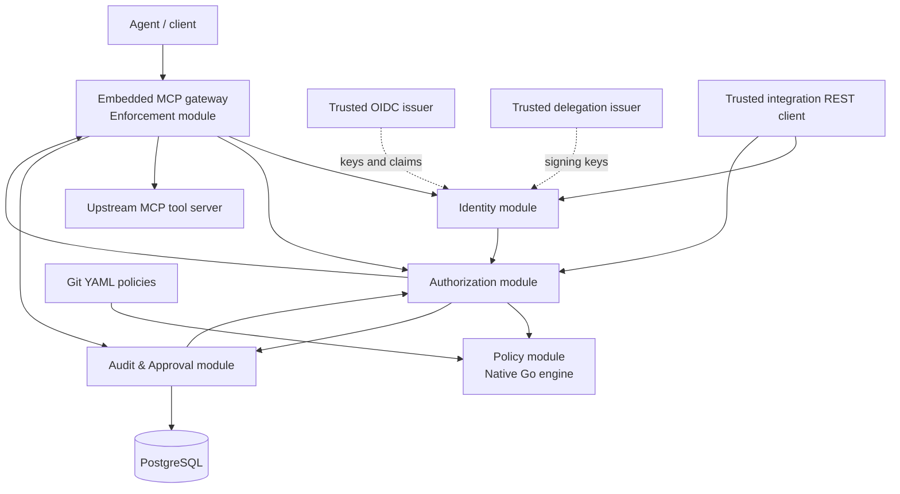

# A05 — Identity and Delegation

**Project:** Authopus  
**Release:** `v0.1.0` (experimental)  
**Target:** November 12, 2026  
**Status:** Architecture and trust-model specification approved; implementation and verification pending  
**Priority:** P0

## 1. Purpose and scope

Define how Authopus establishes **which agent requested what action, under whose authority, on behalf of whom**, and which evidence can be trusted. This document governs the embedded MCP tool-call gateway and the trusted-integration REST authorization API. It does not make Authopus an identity provider, a credential issuer, a general delegation-management service, or a network-level bypass prevention system.

### Confirmed decisions

1. **Agent identity:** Support both (a) an agent with its own OIDC identity and (b) an agent identity asserted by an explicitly trusted, OIDC-authenticated integration.
2. **Delegation evidence:** Signed delegation token, issued by an explicitly trusted issuer; a bare grant ID, unsigned assertion, or caller-provided scope list is not sufficient.
3. **Principal model:** Human-delegated actions and service-owned / workload-authorized actions are supported. An agent may act under its own explicitly granted workload authority, not implicitly inherited user privileges.
4. **Principal authority:** Validate trusted claims and configured Authopus policy; no mandatory per-request external permission lookup.

Other governing decisions: single Go service with five modules (Identity, Policy, Authorization, Enforcement, Audit & Approval); embedded MCP gateway; REST for trusted integrations only; native Go policy engine; `authopus.dev/v1alpha1` YAML policies with multiple rules, default deny, and `deny > require_approval > allow`; one-time approvals with execution-time revalidation; PostgreSQL-backed critical audit records, fail closed on persistence failure; single-organization deployment.

## 2. Identity vocabulary and invariants

| Concept | Meaning | Source of trust |
|---|---|---|
| Caller / workload | Integration or component requesting a decision | Validated OIDC bearer token or authenticated internal service context |
| Agent | Specific AI agent responsible for an action | Verified agent OIDC identity **or** permitted assertion by authenticated integration |
| Principal | Human or service whose authority is being exercised; for agent-owned action, explicitly identified workload/agent principal | Trusted identity claims and authorized binding to the agent |
| Delegation | Signed, scoped, time-bounded authorization linking principal to agent and permitted actions/resources | Verified delegation token from configured trusted issuer |
| Action | Concrete requested operation (v0.1.0: MCP `tools/call`) | Canonicalized by enforcement point, not free-form untrusted policy input |
| Resource | Target MCP server/tool and relevant target identifier | Canonicalized and validated by enforcement point |
| Organization | Single configured organization/deployment security boundary | Server configuration; never accepted solely from untrusted body |
| Context | Other attributes used by policies | Each field has documented provenance and allowed asserting party |

**Invariants:**

- Authentication is not authorization. The caller, agent, principal, delegation and policy must all be valid for the requested action.
- The agent does not inherit all principal permissions. Effective authority is bounded by **caller privileges ∩ agent privileges ∩ verified delegation scope ∩ principal authority ∩ applicable policy** (with each check interpreted as an independent mandatory gate).
- A valid policy `allow` never compensates for absent identity, missing delegation when required, invalid scope or insufficient principal authority.
- Untrusted body fields, forwarded headers, tool arguments and model output cannot promote themselves into verified identity or authority claims.
- Missing or contradictory required evidence blocks execution; an evaluation/infrastructure failure is an `ERROR` and is not disguised as a normal policy `DENY`.
- Identity evidence is never copied verbatim into logs, traces or audit records.

## 3. Trust model

### Mode A — Agent has OIDC identity

An agent presents a valid OIDC token intended for the relevant Authopus integration. Authopus verifies the token and binds the agent to the verified `iss` + `sub` (or an explicit, trusted mapping). The gateway/integration itself is separately authenticated when it calls the authorization interface. The agent identity in a typed request must match verified agent evidence. An integration cannot substitute an arbitrary agent ID.

### Mode B — Trusted integration asserts agent identity

An OIDC-authenticated integration presents a typed agent identifier. Authopus accepts it **only if** configuration explicitly authorizes that caller to assert agent identities in a defined namespace/set. The assertion is attributed to the integration, and audit evidence records that the agent identity was **integration-asserted**, not directly OIDC-authenticated. No blanket trust in `X-Agent-*` headers or arbitrary request-body identifiers.

### Principal types

- **Human principal:** A distinct user identity. A signed delegation token binds the human principal to the agent and limits the requested action/resource. The principal's authority is also checked using trusted claims and policy.
- **Service principal:** A distinct service identity with an explicit signed delegation token authorizing the agent to act for that service.
- **Agent/workload-owned action:** The authenticated agent/workload acts under its **own** explicitly granted authority, with no invented human principal or human delegation. Model this as `authority_mode: self` and a verified principal equal to the authenticated workload/agent identity. Self authority is constrained by trusted workload claims and Authopus policy; it is **not** a way to bypass a required delegation for actions performed on behalf of another principal.

A05 deliberately defines the self-authority exception explicitly: **signed delegation evidence is mandatory for `authority_mode: delegated`, not for `authority_mode: self`**. The API must distinguish the two modes so absence of a delegation token never silently becomes self authority.

## 4. Signed delegation evidence

### Minimum normative claims

The signed delegation token must contain or cryptographically bind the following information:

| Claim / property | Requirement |
|---|---|
| `iss` | Trusted delegation issuer configured for this deployment |
| `sub` | Principal identifier (human or service), with issuer/namespace context |
| `aud` | Authopus or explicitly configured enforcement audience |
| `iat`, `nbf`, `exp` | Issuance, not-before and expiry; short lifetime, bounded clock skew |
| `jti` | Unique token identifier for traceability and replay controls |
| `agent` | Bound agent identity, including issuer/namespace or an equivalent stable identifier |
| `scope` | Explicit allowed operations; must cover the requested action |
| `resources` | Explicit allowed resource identifiers; must cover the requested resource |
| `org` | Configured organization boundary, if represented in token; must match deployment |
| `delegation_id` | Stable grant reference for correlation/revocation checks where available |

The token format may be a signed JWT/JWS or another explicitly specified signed representation. For v0.1.0, **choose and document one interoperable format in A09**, including claim names, issuer trust bootstrap, key rotation, algorithm allowlist, canonical identity representation, maximum TTL, audience semantics and revocation strategy. Never accept `alg=none`, attacker-selected key URLs or arbitrary untrusted JWKS endpoints. Signature verification alone is insufficient: all claims and their bindings must be validated.

### Trust and issuance boundary

Authopus validates delegation evidence but does **not** itself issue general-purpose identity or delegation credentials in v0.1.0. The configured delegation issuer is responsible for authenticating the principal and obtaining valid consent/authority before signing. Authopus verifies the issuer and the requested scope; it does not treat issuer assertions as unlimited permission. Any unsupported issuer, signature algorithm, key, claim mapping or token type is rejected.

For a deployment without a live revocation service, the security model must use bounded short token lifetimes and document that revocation is not instantaneous. An issuer compromise or stolen valid token remains a residual risk until expiry or trusted-key revocation. Revocation requirements beyond this baseline are an A09 implementation decision, not a hidden promise.

## 5. Authorization validation flow

1. **Intercept action.** Embedded MCP gateway receives a supported `tools/call` and derives canonical action/resource identifiers. Other MCP capabilities are out of scope and must not be treated as authorized by this workflow.
2. **Authenticate caller.** Validate OIDC token signature, issuer, audience, lifetime and applicable caller privileges; for internal calls, use authenticated in-process identity context.
3. **Resolve agent identity.** Validate agent OIDC evidence (Mode A) or verify that the caller is allowed to assert this agent (Mode B). Record provenance.
4. **Resolve authority mode and principal.** Require an explicit `delegated` or `self` mode. For delegated mode, verify a distinct human/service principal. For self mode, bind principal to the verified workload identity; do not infer self mode from a missing token.
5. **Verify delegation where applicable.** Validate signature, issuer, audience, validity window, agent/principal binding, action/resource scope, organization and replay-sensitive constraints. Reject mismatches and overbroad claims.
6. **Verify principal and agent authority.** Check trusted claims and configured permission constraints for principal, agent and caller; never accept client-supplied roles/scopes without validated provenance.
7. **Construct trusted authorization context.** Preserve verified versus asserted provenance and remove/reject conflicting untrusted fields.
8. **Evaluate policies.** Native policy engine applies validated `authopus.dev/v1alpha1` rules: matching `deny` overrides `require_approval`, which overrides `allow`; otherwise default deny. Policy evaluation is independent of YAML rule order.
9. **Persist decision evidence.** Write the required audit event to PostgreSQL before releasing a permitted action or approval continuation. If the required write fails, return an error and block execution.
10. **Enforce.** `DENY` blocks; `ERROR` blocks; `APPROVAL_REQUIRED` creates a bounded pending approval and blocks until approval; `ALLOW` permits forwarding only while relevant identity, delegation, policy and approval checks remain valid.
11. **Revalidate on approved execution.** One-time approval is bound to the specific request and is not a reusable grant. Re-check identity, delegation expiry/scope, principal authority, policy, action/resource and approval validity before forwarding; consume approval atomically to prevent replay. Audit decision and observed downstream outcome separately.

### Outcome mapping

| Situation | Outcome | Enforcement |
|---|---|---|
| Verified authority and matching allow rule | `ALLOW` / HTTP 200 | May forward after required audit persistence |
| No matching rule, explicit deny, or insufficient verified authority | `DENY` / HTTP 200 for a successfully evaluated request | Block |
| Verified authority and matching approval rule | `APPROVAL_REQUIRED` / HTTP 200 | Block pending one-time approval |
| Malformed request, invalid authentication, untrusted token, unavailable dependency or required audit write failure | HTTP 4xx/5xx with typed `ERROR` response, as defined in A03 | Block |

**Important distinction:** Invalid credentials and malformed proof are authentication/validation errors, not successful policy denials. A valid, authenticated request that lacks sufficient authority can yield `DENY`. Implementations must follow the A03 error taxonomy consistently.

## 6. Component and trust boundaries

**External trust boundaries:** agent/client → gateway; trusted REST caller → authorization API; OIDC/delegation issuers → Identity module; Git repository → policy activation; gateway → upstream MCP server; Authopus → PostgreSQL. Internal modules share a process but must not share unvalidated identity state or bypass mandatory audit gates.

**Responsibility boundaries:** Identity authenticates and normalizes trusted claims; Policy validates/loads/evaluates policy rules; Authorization combines verified authority and policy outcomes; Enforcement maps MCP calls to decisions and blocks/forwards; Audit & Approval durably records evidence and manages one-time approvals.

**Deployment responsibility:** Authopus cannot stop an agent from reaching an MCP server outside the configured gateway. Operators must restrict direct routes and credentials if bypass prevention is required.

## 7. Threats and mitigations

| Threat | Required mitigation | Test evidence |
|---|---|---|
| Forged or expired OIDC token | Verify signature, issuer, audience, time claims and key trust | Invalid signature, wrong audience, expired token rejected |
| Spoofed agent identity via body/header | Bind agent to verified token or authorized caller assertion; record provenance | Untrusted assertion rejected |
| Confused deputy / agent acting for wrong user | Verify signed principal-agent binding and narrow scopes | Agent/principal mismatch denied |
| Overbroad or forged delegation | Verify signed token, exact action/resource scope and validity | Wrong scope/resource/issuer rejected |
| Replay of delegation or approval | Short token lifetime, unique IDs, context binding; atomic one-time approval consumption | Reused approval cannot execute twice |
| Privilege escalation through context fields | Field-level provenance and allowlisted claims; never trust caller-provided role as verified | Forged role/tenant/context cannot grant access |
| Cross-organization claims | Bind token organization to configured single organization | Wrong-org token rejected |
| Stale identity/delegation/policy after approval | Revalidate at execution and reject expired/changed authority | Approval cannot override changed policy |
| OIDC/JWKS trust substitution | Pin issuer trust, restrict algorithms and key sources, handle rotation safely | Attacker key URL/algorithm rejected |
| Authorization or audit outage | Fail closed; required audit persisted before execution | Database failure produces no upstream call |
| Sensitive claim leakage | Redact tokens/secrets and minimize retained PII | Logs and audit records contain no bearer credentials |
| MCP bypass outside gateway | Explicit deployment trust boundary and operator guidance | Documentation does not claim universal enforcement |

## 8. API contract alignment and required A03 reconciliation

A03 already defines `POST /v1/authorize` for trusted integrations and a typed request with `agent`, `principal`, `delegation`, `action`, `resource`, `context`, and `request_id`. Its current example uses a `delegation.evidence_ref` such as `grant-store:456`. **That reference alone is not signed delegation evidence and does not satisfy A05.**

Before implementing A08/A09/A14, amend A03 OpenAPI and examples to:

1. Represent an explicit `authority_mode` (`delegated` or `self`) as a required discriminant.
2. Require cryptographically verifiable delegation evidence for `delegated` mode (for example a signed token in an authenticated, protected field or a reference that resolves server-side to the signed token); reject a bare unverified grant ID. Define where the proof is carried, without logging it.
3. Make the principal mandatory and identity-bound for delegated mode; define a verified workload/agent principal for self mode.
4. Specify the distinction between directly OIDC-verified and integration-asserted agent identity, with an explicit caller trust configuration.
5. Ensure the typed `ERROR` response and 4xx/5xx status mapping reflect invalid evidence and audit persistence failure, while keeping `DENY` a normal evaluated outcome.
6. Add contract tests for delegated and self modes, issuer/audience mismatch, forged agent assertions, expired delegation, approval-time revalidation and database failure.

This is a **required contract update**, not a change to A01 release scope or the chosen A03 API audience/outcome semantics. The A03 examples are illustrative until reconciled with A05.

## 9. Explicit exclusions and implementation decisions

Not included in v0.1.0: building an IdP, arbitrary OAuth token exchange with downstream MCP servers, external permission lookup for every action, multi-organization tenancy, broad MCP resource/prompt enforcement, general-purpose agent credential issuance, advanced delegation graphs or a web approval UI.

To resolve in A08/A09 rather than A05: exact JWT claim names, issuer allowlists, token format/algorithms, key rotation and cache rules, audience identifiers, proof delivery, maximum delegation TTL, canonical identity names, revocation behavior and principal claim mapping. The rules above remain mandatory regardless of these choices.

## 10. Acceptance criteria

- [x] Distinguish caller, agent, human/service/self principal, delegation, action, resource and trusted context.
- [x] Specify both agent identity models and the conditions under which an integration may assert identity.
- [x] Require signed, scoped, time-bounded delegation for delegated authority and explicitly define self authority.
- [x] Specify principal authority checks based on trusted claims and configured policy.
- [x] Define trust boundaries, validation flow, failure handling and adversarial mitigations.
- [x] Preserve A01–A04 architecture, API outcomes, policy precedence and fail-closed audit semantics.

## 11. Definition of done

- [x] Identity and delegation trust-model document authored with confirmed maintainer decisions.
- [x] Required security tests and threat mitigations documented.
- [x] A03 contract reconciliation requirements explicitly recorded.
- [ ] Reviewed and approved in repository review.
- [ ] Committed as `docs/architecture/identity-and-delegation.md` (or the repository's chosen documentation path) and linked from roadmap/A05.
- [ ] A03 OpenAPI contract/examples updated to reflect signed delegation and explicit authority mode before implementation.
- [ ] A08/A09 security and contract tests implemented and passing when those roadmap tasks are completed.

**A05 status:** Specification complete; repository review/commit and A03 reconciliation outstanding. This document does not claim implementation or CI verification.

## Keycloak implementation contract (#11)

See [Keycloak setup](keycloak-setup.md) for canonical subject IDs, explicit workload bindings, registered-agent assertion permissions, RFC 9068 requirements and lifecycle behavior. Human users remain managed by Keycloak without duplicate Authopus registration.
