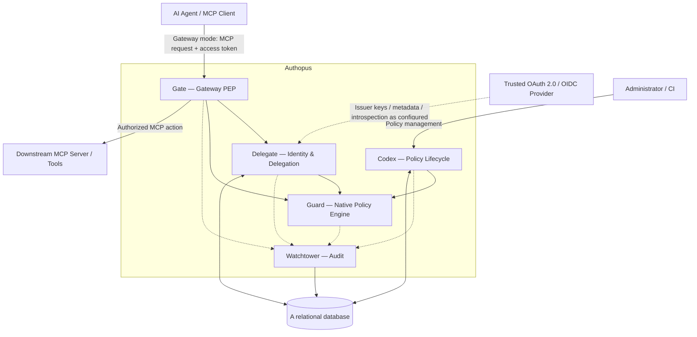

# Authopus — Threat Model

- **Status:** Draft — security design baseline
- **Version:** 0.1
- **Last updated:** 2026-11-02
- **Scope:** Authopus service and its five modules
- **Method:** STRIDE, abuse-case analysis, and trust-boundary review
- **Owner:** Tarang Chikhalia

> This is a design threat model, not a claim that the controls below are implemented or verified. Items marked **Proposed** require explicit architectural approval. Update this model when APIs, deployment topology, identity trust, or policy semantics are specified.

## 1. System purpose and security objectives

Authopus is a open-source security platform for AI agent identity, delegated authority, authorization, enforcement, and accountability. 

Authopus initially protects interactions between AI agents/MCP clients and downstream MCP servers and tools. It is **not** assumed to control the agent's reasoning, all network egress, or tools accessed outside an enforced integration boundary.

Security objectives:

1. Prevent unauthorized MCP actions, including actions exceeding delegated authority.
2. Reject unverified identity/delegation claims and prevent unauthorized cross-deployment access.
3. Make authorization decisions deterministic, explainable, and fail-closed.
4. Prevent policy tampering, bypass, rollback, and inconsistent activation.
5. Record trustworthy evidence of decisions and observable enforcement outcomes.
6. Protect credentials, policy data, tenant metadata, and audit records.
7. Preserve availability under malicious or malformed requests without weakening authorization.

## 2. Scope and assumptions

### In scope

- MCP request/response interception and routing by Gate in gateway, including integration-specific bypass risks.
- OAuth 2.0 / OIDC-based agent authentication, trusted principal context, and separately verified delegated authority evaluated by Delegate.
- Native YAML policy ingestion, validation, evaluation, and activation through Codex and Guard.
- Audit generation and storage by Watchtower.
- Management APIs and administrative policy workflows, when introduced.
- PostgreSQL-backed persistent state (planned technology), scoped to a single-tenant deployment.
- Service configuration, secrets, deployment, and operator access.

### Out of scope for the initial threat model

- Security of the underlying LLM provider and model training process.
- Security of downstream MCP servers beyond Authopus's enforcement boundary.
- Actions made through routes that do not pass through Gate; these remain a known bypass risk that must be explicitly documented and constrained by deployment or application controls.
- Endpoint/device compromise outside the Authopus deployment.
- Guaranteed correctness of tool-side effects after an authorized request is forwarded.

### Confirmed choices and assumptions to validate

| ID | Statement | Status |
|---|---|---|
| A-01 | Gate supports a standalone MCP gateway. | **Confirmed direction; exact interfaces and supported transports TBD** |
| A-02 | Initial Authopus deployment is single-tenant. A deployment's administrative and storage boundary is the tenant boundary. | **Confirmed** |
| A-03 | Agent authentication initially uses OAuth 2.0 / OIDC. | **Confirmed**; token type, issuer configuration and OAuth flow TBD |
| A-04 | Protected gateway-mode MCP servers cannot be reached through an unauthorized alternative path. | **Required deployment condition, not guaranteed by software alone** |
| A-05 | Host applications invoke authorization for every protected action and do not expose unmediated equivalent capabilities. | **Required integration condition** |
| A-06 | Identity is derived from validated token claims and trusted configuration, not client-declared labels. (Identity provider) | **Confirmed; Required control** |
| A-07 | Delegations have independently verifiable grantor, grantee, audience, scope, expiry and revocation semantics. | **Confirmed; grant representation TBD** |
| A-08 | Policies are versioned YAML; only validated and authorized versions become active. | **Planned** |
| A-09 | Guard evaluation has no arbitrary code execution, filesystem, or network side effects. | **Confirmed** |
| A-10 | A relational database provides durable identity, policy and audit state. | **Planned** |
| A-11 | Authopus may observe that Gate forwarded a request without knowing the ultimate tool-side effect. | **Expected limitation** |

### Authentication is not delegation

OAuth 2.0 is an authorization framework and OIDC provides an identity layer. Their tokens and claims do not, by themselves, establish that an AI agent has a particular delegated authority to act for a user. Delegate must validate the token's intended audience, identity, scopes and provenance, then separately establish any delegation relationship required by policy. An ID token intended for a client application must not be accepted as a resource-server access token. JWT validation and opaque-token introspection are distinct implementation options; neither is assumed to be finalized.

## 3. Data flow and trust boundaries

Two deployment/integration modes share Authopus's logical authorization semantics, but have different enforcement guarantees. 

| Boundary | Crossing | Primary risks | Required design controls |
|---|---|---|---|
| **TB-1** | Untrusted MCP client → gateway Gate | Token spoofing, malformed MCP, replay, request smuggling, DoS | Access-token validation, strict parsing, canonicalization, size/time limits, rate limiting |
| **TB-2** | Gateway Gate ↔ downstream MCP server | Direct bypass, tool impersonation, SSRF, mismatched action, untrusted response | Network isolation or destination credentials, trusted server registry, TLS, immutable decision-to-request binding |
| **TB-3** | Agent/Gate ↔ trusted OAuth/OIDC issuer and token-verification material | Forged tokens, issuer mix-up, wrong audience, ID/access token confusion, stale JWKS, compromised issuer | Pinned trusted issuers, allowed algorithms, audience/type/expiry checks, controlled JWKS refresh, introspection where needed |
| **TB-4** | Administrator/CI → Codex and management APIs | Policy tampering, compromised CI, privilege escalation | Admin authentication and authorization, change review, provenance, validation, audit |
| **TB-5** | Modules ↔ database | Data disclosure, injection, tampering, audit deletion | Least-privilege DB roles, parameterized queries, encryption, backup/restore, deployment isolation |
| **TB-6** | Internal logical module boundaries | Confused deputy, bypass of Guard, untrusted context propagation | Typed internal APIs, trusted identity context, enforced call paths, tests |
| **TB-7** | Deployment/configuration/secrets → service and SDK host | Secret theft, insecure configuration, supply-chain compromise | Secret management, secure defaults, build provenance, hardening, SDK version management |

## 4. Protected assets and security properties

| Asset | Required property |
|---|---|
| Agent and principal credentials | Confidentiality, integrity, short-lived validity where possible |
| Delegation grants and revocation state | Authenticity, integrity, freshness, bounded authority |
| Policy source and active policy version | Integrity, authorized activation, reproducibility |
| Authorization context and decisions | Authenticity, determinism, tenant isolation |
| MCP requests and tool outputs | Integrity, confidentiality where sensitive, bounded processing |
| Audit records and correlation identifiers | Integrity, traceability, controlled access, retention |
| Administrative interfaces and configuration | Strong authentication, least privilege, change accountability |
| Service and database availability | Resilience without fail-open behavior |

## 5. Threat actors and attacker capabilities

- **Malicious or compromised agent/client:** Can submit arbitrary MCP requests, manipulate agent-supplied context, replay messages, and attempt tool abuse.
- **Prompt-injection author:** Controls instructions embedded in retrieved documents, tool descriptions, or tool responses, attempting to influence agent behavior.
- **Compromised MCP server/tool:** Can return malicious data, misrepresent outcomes, or exploit forwarding behavior.
- **Malicious tenant/user:** Has valid low-privilege access and attempts lateral movement or policy bypass.
- **Compromised administrator/CI credential:** Can attempt unauthorized policy changes or audit suppression.
- **External network attacker:** Can probe exposed endpoints, exhaust resources, or exploit transport misconfiguration.
- **Supply-chain attacker:** Can compromise dependencies, build artifacts, or deployment images.

A fully compromised Authopus host or trusted database administrator is a high-impact scenario; process isolation alone does not protect against it in a modular monolith.

## 6. STRIDE analysis and prioritized abuse cases

Priority is **provisional**: Critical / High / Medium. Reassess using deployment exposure, exploitability, and business impact once concrete APIs exist.

| ID | STRIDE | Threat scenario | Modules / boundaries | Priority | Proposed mitigations |
|---|---|---|---|---|---|
| T-01 | Spoofing | Agent supplies a forged principal identifier or misleading deployment context | Gate, Delegate / TB-1 | **Critical** | Verify credential-derived identity; never trust caller-supplied identity fields; bind identity to the configured deployment and issuer |
| T-02 | Elevation | Agent claims authority exceeding the actual delegation | Delegate, Guard / TB-1, TB-8 | **Critical** | Verify issuer, audience, subject, scopes, expiry, and delegation chain; effective permissions cannot exceed grantor authority |
| T-03 | Elevation | Client bypasses Gate and calls MCP server directly | Gate / TB-2 | **Critical** | Network isolation or server-side credential controls; prohibit unmediated routes; deployment tests |
| T-04 | Tampering | Policy changed or activated by unauthorized actor | Codex / TB-6 | **Critical** | Admin authorization, version integrity, provenance, validation, atomic activation, audit trail |
| T-05 | Elevation | Guard interprets missing/unknown attributes as permissive | Guard / TB-8 | **Critical** | Typed semantics, explicit unknown behavior, deny by default, property tests, fail closed |
| T-06 | Tampering | Policy parser ambiguity, type coercion, or duplicate YAML keys changes meaning | Codex, Guard | **High** | Strict schema, reject duplicate keys, canonical form, bounded input, parser fuzzing, differential tests |
| T-07 | Tampering | TOCTOU: delegation revoked or policy changed between check and use | Delegate, Guard, Gate | **High** | Defined freshness/consistency model, bounded decision lifetime, request binding, recheck sensitive operations where needed |
| T-08 | Spoofing | Attacker impersonates downstream MCP server or redirects destination | Gate / TB-2 | **High** | Destination allowlists, server identity validation, TLS, no arbitrary target URLs, SSRF protections |
| T-09 | Elevation | Tool name/arguments evaluated differ from forwarded request | Gate, Guard / TB-1, TB-2 | **Critical** | Canonical authorization request, immutable evaluated fields, exact request-to-decision binding, end-to-end tests |
| T-10 | Information disclosure | Cross-deployment reads or policy/audit leakage | All / TB-7 | **Critical** | Deployment isolation, restricted database credentials, isolation tests, least-privilege database roles |
| T-11 | Repudiation | Decision or action cannot be reliably attributed | Watchtower, Gate, Delegate | **High** | Trusted actor identity, request/decision IDs, policy version, event integrity, synchronized clocks |
| T-12 | Tampering | Audit events are dropped, altered, or deleted | Watchtower / TB-7 | **High** | Append-oriented design, restricted writes, integrity verification, retention controls, delivery monitoring |
| T-13 | Information disclosure | Credentials, prompts, tool arguments, or PII leak through audit/logs | Watchtower / TB-7 | **High** | Data minimization, redaction, field allowlists, access controls, retention limits |
| T-14 | Denial of service | Expensive expressions, deep nesting, malformed YAML, or high request volume exhaust resources | Guard, Codex, Gate | **High** | Evaluation budgets, nesting/size limits, timeouts, bounded concurrency, rate limits, fuzz and load tests |
| T-15 | Elevation | Prompt injection persuades agent to request unauthorized tools/actions | Agent, Gate, Guard / TB-1 | **High** | Treat agent intent and tool content as untrusted; enforce independently of prompts; least privilege and context-bound policies |
| T-16 | Tampering | Malicious tool response influences later authorization context | Gate, Delegate, Guard / TB-2 | **High** | Separate trusted claims from tool-provided data; taint/provenance-aware context; reauthorize each action |
| T-17 | Spoofing | Stolen/replayed tokens or delegation credentials | Delegate / TB-1 | **High** | Short lifetimes, audience binding, secure transport, rotation/revocation; replay protection where protocol permits |
| T-18 | Elevation | Internal module caller bypasses Guard via a shortcut | Gate, Guard / TB-8 | **High** | Centralized enforcement entry points, narrow interfaces, integration tests, code review |
| T-19 | Tampering | Rollback to stale permissive policy or stale delegation snapshot | Codex, Guard, Delegate | **High** | Monotonic version checks where applicable, atomic activation, freshness bounds, rollback authorization |
| T-20 | Denial of service | PostgreSQL or audit pipeline failure causes uncontrolled authorization behavior | All / TB-7 | **High** | Explicit fail-closed rules for required state, bounded queues, operational health checks, documented audit failure policy |
| T-21 | Information disclosure | Detailed deny explanations reveal sensitive policies or attributes | Guard, Gate | **Medium** | Separate public-safe reasons from privileged diagnostic traces; access control and redaction |
| T-22 | Tampering | Compromised dependency or release artifact executes malicious code | Service / TB-9 | **High** | Dependency review, pinned builds, SBOM, signing/provenance, vulnerability scanning, release controls |
| T-23 | Repudiation | Forwarded request is mistaken for successful tool execution | Gate, Watchtower / TB-2 | **Medium** | Separate requested, authorized, forwarded, responded, and outcome-observed states |
| T-24 | Elevation | Administrative policy tester/debug endpoint evaluates with elevated privileges | Codex, Guard / TB-9 | **High** | Strict separation of test and production evaluation, RBAC, safe fixtures, no debug bypass |
| T-25 | Elevation | SDK host skips authorization, calls a tool directly, or ignores deny/obligations | Gate SDK / TB-6 | **Critical** | Host integration contract, secure reference integrations, mandatory call-site tests, no equivalent unmediated credentials where possible |
| T-26 | Tampering | SDK authorizes one tool/action/argument set but host executes another | Gate SDK, Guard / TB-6 | **Critical** | Bind decision to canonical immutable action and parameters; prevent post-check mutation; short decision lifetime |
| T-27 | Spoofing | Wrong OAuth issuer/audience, unsigned or weak-algorithm JWT, or ID token accepted as API access token | Delegate / TB-5 | **Critical** | Trusted issuer allowlist, strict algorithm and token-type validation, signature/expiry/audience checks, negative tests |
| T-28 | Elevation | Valid agent access token is misinterpreted as proof of user delegation | Delegate, Guard / TB-5, TB-8 | **Critical** | Distinct agent/principal/delegation model; verify delegation grant and effective permissions independently |
| T-29 | Tampering | Compromised or stale JWKS/introspection response leads to accepting revoked or attacker-issued tokens | Delegate / TB-5 | **High** | Trusted TLS endpoints, controlled key rotation/cache, bounded freshness, fail closed on unavailable required verification |
| T-30 | Spoofing | Attacker forges remote SDK authorization response or replays prior allow decision | Gate SDK / TB-4 | **High** | Authenticated channel, decision correlation, expiry, audience/request binding, fail closed |
| T-31 | Information disclosure | Independent single-tenant deployments accidentally share database, secrets or issuer settings | Deployment / TB-7, TB-9 | **High** | Per-deployment isolation, deployment-specific credentials, configuration validation, cross-deployment tests |
| T-32 | Denial of service | OIDC issuer or introspection endpoint unavailable and SDK/gateway fails open | Delegate, Gate SDK / TB-4, TB-5 | **Critical** | Explicit fail-closed behavior, bounded verification caches with defined revocation tradeoffs, failure injection tests |

## 7. Module-specific security requirements

### Gate — enforcement

- Gate must authorize **every protected operation** before forwarding it.
- Normalize the action, resource, tool identifier, arguments, tenant, and authenticated actor into a typed authorization request.
- Ensure the exact forwarded operation matches the evaluated operation; reject ambiguous or modified requests.
- Enforce allow/deny and supported obligations; if a required obligation cannot be applied, deny.
- Restrict destinations and handle redirects, protocol upgrades, streaming, and tool responses explicitly.
- Define behavior for MCP tools, resources, prompts, notifications, and sessions before claiming comprehensive MCP coverage.

### Delegate — identity and delegation

- Authenticate the actor independently of untrusted request content.
- Distinguish agent identity, principal identity, and delegation grant.
- Validate delegation scope, audience, expiry, chain depth, revocation, and authority attenuation.
- Prevent delegation escalation, cross-tenant impersonation, and ambiguous principal resolution.
- Specify a freshness policy for revocation and credential caches.

### Guard — native policy evaluation

- Define a formal policy evaluation contract: input schema, types, operators, missing/unknown behavior, conflict resolution, and output.
- Deny by default; explicit applicable deny overrides allow; errors fail closed.
- Ensure deterministic results for identical normalized inputs and policy versions.
- Do not permit policies to execute arbitrary code or access the network/filesystem as a side effect.
- Limit evaluation time, expression complexity, recursion, memory, and policy size.
- Fuzz parsers/evaluator and test adversarial edge cases, including type confusion and policy precedence.
- Bind decision explanations to the evaluated policy version and redact sensitive details for unprivileged callers.

### Codex — policy lifecycle

- Enforce administrative authorization for create, edit, approve, activate, and rollback actions.
- Strictly validate YAML and reject ambiguous or unsupported constructs.
- Record immutable policy version identifiers and activate changes atomically.
- Support safe policy tests and change review; avoid accidental production activation.
- Establish how policy state propagates to Guard and what happens when it becomes stale.

### Watchtower — accountability

- Correlate actor, delegation, request, decision, policy version, enforcement action, and observed outcome.
- Distinguish a decision to allow from actual downstream execution success.
- Prevent untrusted fields from overwriting trusted identity or event metadata.
- Minimize sensitive content in logs and protect audit data from unauthorized modification/deletion.
- Define retention, export, backpressure, and audit delivery failure behavior.

## 8. Core security invariants

The following should become automated tests and release gates:

1. **No verified identity → no privileged action.**
2. **No valid applicable allow → deny.**
3. **Applicable explicit deny → deny, regardless of allows.**
4. **Evaluation error, unknown critical attribute, or invalid policy → deny.**
5. **Requested action outside effective delegated authority → deny.**
6. **Tenant mismatch → deny and do not disclose other tenant data.**
7. **Decision does not match exact forwarded operation → do not forward.**
8. **Required enforcement obligation not fulfilled → do not forward.**
9. **Unauthorized policy activation → reject and audit.**
10. **Audit records never imply tool execution succeeded solely because authorization allowed it.**

## 9. Example attack scenarios

### Scenario A — Forged delegated authority

1. An agent submits a request claiming to act as a privileged user.
2. Gate extracts the claim but does not treat it as trusted.
3. Delegate verifies credentials and the delegation chain.
4. Guard evaluates only the verified effective authority.
5. Missing or invalid delegation causes denial; Watchtower records the attempt.

### Scenario B — Prompt injection through a tool result

1. A lower-trust MCP tool returns content instructing the agent to call a sensitive tool.
2. The agent attempts the sensitive action.
3. Gate treats the new request as a separate authorization event.
4. Guard evaluates actual authority and policy, not the tool's instructions.
5. Unauthorized action is denied even if the agent follows the malicious prompt.

### Scenario C — Policy ambiguity exploit

1. An attacker submits or influences YAML containing duplicate keys or surprising type coercions.
2. Codex rejects ambiguous input rather than guessing its meaning.
3. Guard only evaluates validated, versioned policies.
4. Parser fuzzing and schema tests verify consistent behavior.

### Scenario D — Enforcement bypass

1. A client tries to call a protected MCP server directly instead of through Gate.
2. Network or downstream credential restrictions prevent the direct call.
3. Deployment verification confirms the protected route is not reachable without enforcement.

## 10. Security verification plan

| Area | Minimum verification |
|---|---|
| Identity and delegation | Forged claims, expired grants, audience mismatch, revocation, privilege attenuation, replay |
| Policy engine | Unit/property tests, precedence matrix, missing/unknown semantics, parser/evaluator fuzzing |
| MCP enforcement | Request normalization, exact decision-to-forward binding, transport variants, bypass attempts |
| Policy lifecycle | Unauthorized edits, malicious YAML, rollback, activation atomicity, stale policy behavior |
| Tenant isolation | Cross-tenant API, storage, policy, and audit access tests |
| Audit | Event correlation, redaction, integrity, backpressure, outage handling |
| Availability | Resource exhaustion, malformed inputs, database failures, bounded timeouts |
| Supply chain | Dependency and artifact scanning, reproducible build checks where feasible |

Suggested security gates:

- **Before first end-to-end prototype:** Demonstrate deny-by-default and exact-request enforcement.
- **Before public alpha:** Complete identity/delegation abuse tests and policy fuzzing baseline.
- **Before public beta:** Validate supported deployment bypass protections and multi-tenant isolation (if supported).
- **Before stable release:** Complete documented threat review, operational failure testing, and external security review where feasible.

These are proposed release criteria, not existing project milestones or claims of completion.

## 11. Residual risks and limitations

- SDK enforcement is cooperative with the host application; Authopus cannot guarantee coverage when the host bypasses the SDK or disregards a decision.
- A single-tenant application design does not eliminate cross-deployment exposure from shared infrastructure or misconfiguration.
- OAuth/OIDC token validation does not automatically provide proof of delegated user authority; separate delegation evidence is required.
- Availability and revocation freshness can conflict when issuer metadata, JWKS or introspection is unavailable; the security posture must be explicitly specified and tested.

- A policy can authorize a harmful action if its rules or trusted inputs are incorrect.
- A compromised downstream tool can misreport its actual side effects.
- Prompt injection cannot be eliminated solely by an authorization gateway; Authopus constrains effects at protected boundaries.
- Enforcement is incomplete when agents can access equivalent tools through uncontrolled channels.
- A compromised Authopus host may affect all five modules because they share one process and deployment.
- Custom policy evaluation increases responsibility for parser safety, semantic correctness, testing, and security maintenance.
- Audit integrity depends on deployment privileges, storage controls, and retention configuration.

## 12. Remaining open design decisions

The following are **not** settled by the confirmed choices above:

1. **Gateway/SDK contract:** Is the SDK a thin remote client to the Authopus service, or can it evaluate locally? Which operations, MCP transports, and SDK languages are in v1?
2. **Gateway bypass resistance:** How are downstream MCP servers isolated and what credentials do they accept?
3. **OIDC/OAuth profile:** Which grant flows, token formats, issuer(s), discovery rules, audience values, JWT/JWKS validation or opaque-token introspection are supported?
4. **Delegation:** Who issues delegation grants, how are they bound to agent and user identities, and how are they revoked?
5. **Token lifecycle:** What are clock-skew limits, key rotation policy, cache freshness and revocation guarantees?
6. **Policy administration:** Who may activate policies and what approval or rollback controls are required?
7. **Audit failure policy:** Must persistence failures block actions, or can events be durably buffered?
8. **Audit data handling:** Which arguments, tool outputs, token identifiers and personal data are retained, redacted, hashed or excluded?
9. **Release requirements:** What are acceptable latency, availability and formal compliance targets?
10. **Future multi-tenancy:** If ever introduced, create a new threat-model revision covering tenant routing, data isolation, authorization scopes and shared-control-plane risks.

## 12.1 Security verification additions for the confirmed choices

- Run the **same allow/deny/unknown/error authorization test vectors** through gateway and SDK integrations and compare effective enforcement outcomes.
- Attempt to bypass the SDK in reference host integrations and call downstream tools directly; document the exact protection boundary.
- Mutate tool names, arguments and destination after an SDK allow decision; ensure execution is rejected or reauthorized.
- Test expired, not-yet-valid, wrong-audience, wrong-issuer, wrong-token-type, unsigned, weak-algorithm, malformed and replayed access tokens.
- Test JWKS rotation, cache expiry, issuer outage and introspection outage without a fail-open path.
- Test that a valid agent token **without delegation evidence** cannot perform a delegated-only action.
- Deploy two isolated single-tenant instances and verify no shared secret, database, policy or audit access.
- Verify both integration modes preserve request/decision correlation and accurately distinguish authorization, forwarding and observed execution.

## 13. Review and maintenance

Review this model whenever a new trust boundary, authentication scheme, policy operator, MCP transport, persistence mechanism, or administrative capability is introduced. For each change:

1. Update the data-flow diagram and trust boundaries.
2. Add or revise threat scenarios and priorities.
3. Assign an owner to each required mitigation.
4. Link mitigations to implementation issues and automated tests.
5. Record accepted residual risks and approval rationale.

**Related documents:** `README.md`, `docs/roadmap.md`, `docs/decisions/ADR-001-modular-monolith.md`, `docs/decisions/ADR-002-go-primary-language.md`, `docs/decisions/ADR-003-native-policy-engine.md`.
